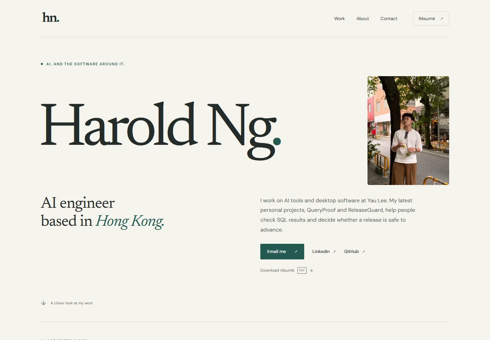
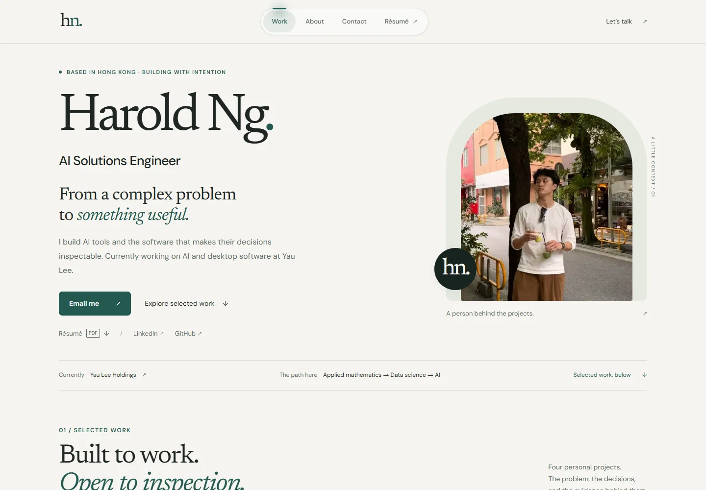
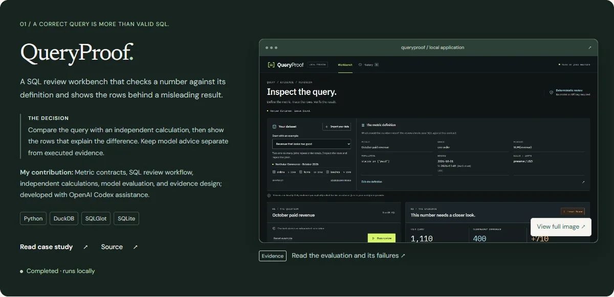

# Portfolio design upgrade

Implemented the approved design on 18 November 2026. Harold's current title is **AI Solutions Engineer** in the homepage, experience, metadata, résumé and social preview.

## What changed

The homepage uses an ivory, graphite and teal palette, Newsreader headings, DM Sans body text and Harold's existing photos. QueryProof and ReleaseGuard have larger project panels; Relay Desk and IFC-GPT remain visible supporting projects. Each panel includes the problem, decision, contribution, source and evidence. The approach section and chronology connect the work to Harold's experience.

All four case studies now share a reading guide, contribution/status/stack overview, framed evidence, a four-step workflow, desktop section navigation, native mobile contents and a related project. Existing project narratives, measured results, limitations, URLs and downloads are retained.

The [adoption record](COMPONENT-ADOPTION.md) identifies the actual author files adapted from the selected 21st.dev components, their revisions, licenses and changes. Serenity supplies the Tubelight Navbar foundation, Tailark the Features Eight/Card foundation, and Arc the licensed timeline alternative. Only navigation hydrates. Project cards render as static React; the chronology is a source-preserving Astro port. No React Bits component or gated integration prompt is claimed as incorporated.

## Visual evidence

Before, captured from the previous live release:

Updated desktop homepage:

Updated project treatment:

[Mobile homepage](images/design/after-mobile.webp) · [Case-study overview](images/design/case-after.webp)

## Runtime and loading decisions

- Navigation retains native links and static selected-state styling before hydration. JavaScript enhances its active indicator, scroll tracking and header-aware anchor spacing. Reduced motion removes indicator travel.
- The complete first-party JavaScript budget is **72,258 bytes gzip**: 70,209 bytes across all three external chunks plus 2,049 bytes for the largest per-route sum of separately gzipped inline scripts. All external chunks belong to the navigation loaded on page entry; there are no extra interaction-triggered chunks. This conservative accounting includes the React runtime and Astro bootstrap. The build fails above 90,000 bytes.
- Portrait AVIF sources at 240, 480, 576 and 720 px retain the original WebP fallback. They were encoded with Pillow at quality 45, speed 6; the 576 px version is resized from the existing 720 px WebP. The portrait remains eagerly requested with high priority. Existing photos and project evidence retain explicit dimensions and appropriate lazy loading.
- Newsreader loads the normal and italic 400 styles actually used by the design. The three above-fold Latin font files are preloaded; no external font service is needed. Font licenses remain in `public/fonts/`.

An initial controlled local run exposed a 3.90-second median LCP, with the portrait as the LCP element. Responsive AVIF, smaller font files and earlier font discovery brought the final three-run median to 2.33 seconds. The intermediate reports are retained locally rather than discarded. This is a local production-build measurement, not a real-user speed claim.

## Verification and release

See [verification](VERIFICATION.md) for the checks and measurement conditions. Required GitHub CI includes the design browser journeys and the JavaScript build budget. The release follows the existing protected-main workflow; the release PR records the actual merged commit, deployed version and hosted verification after deployment.

The optional spotlight hover effect, copy-email widget and screenshot lightbox were omitted. Native email, download and full-image links provide their core functions without another interaction layer. WebKit automation is reported as WebKit coverage, not a real-device Safari session.
