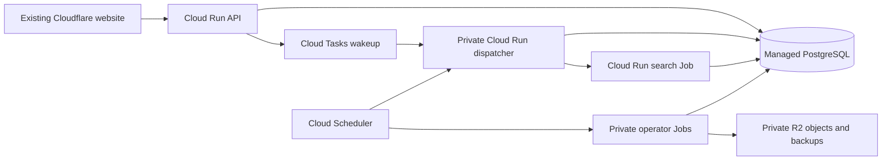

# Research workspace serverless deployment

Product requirements document. Version 1.1. November 25, 2026, Asia/Hong_Kong.

Status: proposed work for review. The completed [capacity-wait implementation](RESEARCH-CAPACITY-IMPLEMENTATION.md) is the starting point. This document does not claim that a serverless deployment exists or authorize a paid plan, cloud provisioning, or public launch.

## Purpose and outcome

Deploy the research application without depending on Oracle VM availability or the researcher's computer. Use Google Cloud Run for the API and search executions, managed PostgreSQL for durable application state, the existing Cloudflare portfolio for the interface, and private R2 for recovery.

Visitors must retain the same browsing, statistics, evidence, saved links, and bounded team searches. The operator should maintain application releases and data recovery without maintaining a VM operating system. Preserve the tested Python solver and PostgreSQL model.

Oracle was a proposed low-cost host, not an application dependency. If this PRD is approved for implementation, Cloud Run becomes the preferred deployment path. The existing VM package remains a recovery and comparison option. The [capacity-wait PRD](RESEARCH-CAPACITY-WAIT-PRD.md) remains authoritative for download removal, research semantics, and private recovery. Its Oracle-first hosting requirement is replaced for this migration. Native ARM testing is no longer a launch gate for an x86 Cloud Run release.

Writing this PRD does not change the existing Oracle monitor or extend its November 26, 14:39 Hong Kong expiry. Stop redundant monitoring when a replacement deployment is accepted. Do not delete credentials, backups, or the VM package as part of that change.

## Scope and decisions

| Area | Required direction |
| --- | --- |
| Interface | Keep the existing Astro application and Cloudflare hosting. Preserve public routes, copied links, accessibility, and portfolio release checks. |
| API | Deploy the existing FastAPI container as a Cloud Run service with zero minimum instances. Keep enumeration outside visitor requests. |
| Search | Execute bounded Python workers as Cloud Run Jobs. Preserve NumPy, Numba, frozen rules, and independent result validation. |
| Dispatch | Persist dispatch intent with accepted work. Deliver authenticated wakeups to a bounded dispatcher, with scheduled reconciliation for missed wakeups and interrupted jobs. |
| Database | Keep PostgreSQL 17 as the compatibility baseline. Evaluate Neon first for intermittent use and Cloud SQL as a same-cloud alternative. Select one provider and plan from measured compatibility, latency, and total cost. |
| Recovery | Retain private R2 backups and their verification contract. Adapt operator jobs to managed database permissions and temporary local storage. |
| Cost | Minimize recurring spend. A free compute allowance is not a promise that the complete application costs nothing. The owner approved setup with total monthly spending strictly below US$5 on November 25; configuration uses US$4.99 as the maximum across all providers, environments and experiments. The current design must be requalified against this ceiling before provisioning. |

Moving the database to D1, rewriting the solver for Workers, adopting Cloudflare Containers, adding user accounts, building a new dashboard, collecting new matches, and changing research interpretation are outside this migration. Cloud Run functions are unnecessary for the existing container boundary. These alternatives can be reconsidered if the selected design fails its cost or compatibility review.

## Existing evidence and its limits

| Evidence | Interpretation |
| --- | --- |
| Linux deployment rehearsal, API checks, browser journeys, and statistics verification passed. | Application behavior has a tested baseline. Cloud Run networking, scaling, permissions, and failure recovery still require hosted tests. |
| General query produced 280,543 configurations and 211,961 champion sets. Jazz produced 38,809 configurations and 30,935 sets. | These are reference results for the recorded publication and ruleset, not permanent counts for future snapshots. |
| General worker elapsed time was 115.5 seconds on the local Windows machine. A separate warm solver-only run took 65.662 seconds. | These measurements have different scopes. Neither predicts Cloud Run runtime or cost. Measure startup, compilation, enumeration, and persistence separately. |
| The restored database occupied 1,758,582,451 bytes after recomputation. | This includes local allocated space. Measure a clean import and the provider's billable storage before deciding whether a free tier fits. |
| A real private R2 restore verified 248 objects and saved query result hashes. | Preserve the format and consistency checks. Repeat recovery using the selected managed PostgreSQL service. |

The [verification record](RESEARCH-CAPACITY-IMPLEMENTATION.md) links the exact fixtures, source hashes, timings, and reports. Preserve source publications, evidence, rulesets, and saved definitions. Reducing disposable result retention is a separate measured tradeoff between database storage and recomputation cost.

## Target architecture

Cloud Tasks carries wakeups. PostgreSQL holds the authoritative query state and dispatch intent. The dispatcher can share the application image but must have a separate private endpoint and service identity. Scheduler-triggered operator executions use authenticated invocation. No client receives cloud execution credentials.

Cloud Run supports Linux x86_64 containers. Its default writable filesystem is temporary and consumes instance memory. Keep durable database and object state outside the container. Pin application image digests and record Python, PostgreSQL client, and dependency versions. [Cloud Run runtime contract](https://docs.cloud.google.com/run/docs/container-contract)

## S1. Managed PostgreSQL qualification

Deliver a provider comparison and a clean import report before selecting the production database.

1. Compare an orderable Neon plan and Cloud SQL configuration in regions close to the chosen Cloud Run region. Record round-trip latency from Cloud Run, connection limits, sleep behavior, storage accounting, network charges, and required networking components. Test the exact plan and endpoints proposed for launch.
2. Restore or import the intended publication scope into an empty isolated application namespace. Measure source tables, evidence, indexes, saved definitions, result caches, total allocated size, and provider-billed storage separately. Include provider history, branches, and other charged storage where applicable. Measure growth from a fresh full search and allow headroom for the next publication, retained results, and operator work. Do not infer storage size from compressed backup bytes or delete retained results to make a plan appear to fit.
3. Verify PostgreSQL transactions, JSONB, row-level security, advisory locks, queue locking, migrations, and publication isolation. Build a permission matrix for the API, dispatcher, worker, importer, backup reader, and restore operator. API and worker logins must have no ownership or administrative grants that bypass their intended access boundaries.
4. Adapt the current `CREATE ROLE`, `BYPASSRLS`, ownership, and restore assumptions to the provider's supported permissions. Inventory application-owned schemas, roles, grants, and dependencies with an explicit allowlist. Record the provider-owned baseline and leave its schemas and roles untouched. Do not solve a failed permission check by giving an API or worker the database owner login. A backup reader must see every required private row without gaining application write permissions. Reject a provider configuration that cannot satisfy the access and recovery contract.
5. Select connection endpoints by operation and require authenticated TLS with certificate verification. Confirm Cloud Run can reach the selected endpoint and include any VPC, address, or network costs. Transaction pooling must pass the application's transaction and role tests. Use direct or otherwise session-affine connections for exported snapshots, session advisory locks, migration locks, and operator work. Verify backup and cleanup exclusion through the actual endpoints. [Neon connection pooling](https://neon.com/docs/connect/connection-pooling)
6. Bound total connections across API replicas, dispatchers, search executions, and operator jobs. Reserve administrative capacity and test exhaustion. Retries must be bounded and preserve the original request identity.
7. Replace the VM filesystem free-space check with admission based on managed database capacity, result-growth reservations, and configured limits. Define how stale or unavailable capacity measurements stop new allocations while cached results and ordinary reads remain usable when the database permits. Container temporary-space checks are separate.

Neon currently lists 1 GB storage and 100 CU-hours per project on Free. Cloud SQL lists separate compute, storage, and network charges. Neither establishes the price of this application. Date and recheck the selected quote before provisioning. [Neon pricing](https://neon.com/pricing), [Cloud SQL pricing](https://cloud.google.com/sql/pricing)

## S2. API, identity, and visitor behavior

Deploy the API with explicit CPU, memory, request concurrency, maximum instances, connection pool size, timeouts, allowed origins, and a shared session secret. Start with zero minimum instances. Store secrets in the platform secret service and bind them only to the identities that need them.

Preserve HTTP contracts, pagination limits, query deduplication, subscription ownership, cancellation permissions, and snapshot selection. Query acceptance returns the existing job identity or an actionable rejection. It must not wait for search-worker startup or enumeration. API cold starts remain part of the user-facing response target. Cached-query reuse must not launch new work.

Replace the fixed Compose proxy address with verified Cloud Run ingress and client-address handling. Test forged forwarding headers and direct access to the service URL. Replicas must apply shared session and network quotas consistently. A visitor must not bypass limits by switching API instances or using an alternate hostname.

Separate process liveness from database readiness and search availability. Infrastructure probes must not increment visitor quotas or write through the existing public-read dependency. Worker inactivity is normal when the queue is empty. Readiness must expose stalled accepted work without requiring an always-running worker. Record any probes that wake a sleeping database.

Keep all research download listings, delivery routes, signed URLs, and query exports retired. GET and HEAD requests must return 404 or 410. A database outage must remain distinguishable from empty research data. Preserve unknown, zero, false, empty text, provenance, and observation-denominator semantics.

## S3. Reliable search dispatch and execution

An accepted query must survive API termination, missed wakeups, duplicate deliveries, worker termination, and service scale-to-zero.

1. Commit the queued query and its dispatch intent in the same database transaction. The dispatch intent is an outbox record: durable work describing what still needs to be launched. No commit means no accepted job.
2. Use Cloud Tasks to wake an authenticated dispatcher. Keep task messages limited to identifiers, never SQL, shell commands, or credentials. Treat wakeup delivery as repeatable. A failed task creation after the database commit must remain recoverable from the outbox. Do not rely on an untracked background thread after returning the HTTP response. [Cloud Tasks with Cloud Run](https://docs.cloud.google.com/run/docs/triggering/using-tasks)
3. The dispatcher claims eligible work, records launch intent, and invokes an allowlisted Cloud Run Job. Handle launch rejection and uncertain acknowledgements. Repeated wakeups must not create unbounded executions or publish duplicate results. Protect execution reservations with expiry and recovery rules.
4. Enforce global limits for queued work, outstanding Job executions, active searches, and attempts across all API replicas and dispatchers. Count launching, running, retrying, and uncertain launches against the outstanding-execution limit. Reservation expiry alone must not release capacity while the original execution could still run. Reconcile its actual outcome before replacing that reservation. Per-execution task parallelism is not a global limit. Bound launch rate as well as solver concurrency so rejected or duplicate executions cannot create uncontrolled bills.
5. Bind each worker attempt to the intended query and generation, or prove an equivalent claim protocol. The current `--once` mode can claim another queued query or exit without work. Do not treat that exit as proof that the requested query ran. When capacity is full, retain an eligible retry instead of losing the wakeup.
6. Preserve lease ownership, attempt limits, cancellation ownership, and fencing. A superseded worker must not write results or mark a newer attempt complete. Renew leases during compilation and long persistence phases. Completion must be atomic with the final counts and state.
7. Define process exit and retry behavior for success, transient infrastructure failure, cancellation, invalid queries, and resource limits. Coordinate Cloud Tasks, Job, and application retries within one finite compute-attempt budget. Deterministic failures and completed queries must not trigger repeated paid enumeration.
8. Reconcile committed outbox records, uncertain launches, and expired leases without requiring a later visitor request. Under healthy dependencies and available admission, accepted work must start within 60 seconds. After a dispatch failure, recover eligible work within 15 minutes of dependencies becoming healthy. These are proposed launch criteria, not measured guarantees. Changing either bound requires an explicit PRD revision. Record capacity-induced queue wait separately.
9. Replace the permanent two-second polling loop with bounded executions. Scheduled reconciliation must have a documented cadence, duration, and empty-queue behavior. Measure its database wakeups and billable usage. Do not claim zero idle database cost if reconciliation prevents sleep.

A longer platform timeout must not silently relax the application's 120-second exhaustive-search target. Configure enough task time for startup, the bounded search, persistence, and shutdown. Record platform timeout separately from the application execution limit. [Cloud Run Job timeout](https://docs.cloud.google.com/run/docs/configuring/task-timeout)

## S4. Private objects, backup, and scheduled operations

Run imports, backup, verification, retention, and cleanup as separate operator Jobs. Replace systemd scheduling and local report files with authenticated scheduling, durable sanitized reports, and an operator-visible failure notification.

Use private R2 as the authoritative location for registered immutable source objects, retained legacy query objects, and completed backup sets. Establish separate object and backup namespaces with explicit credentials and retention rules. The ordinary API and search worker must continue to work without R2 credentials or artifact mounts.

Operator jobs may stage verified objects temporarily. Bound staging bytes, memory, duration, and cleanup. Account for Cloud Run's memory-backed filesystem before using the current full-copy backup flow. Reject a workload that exceeds configured capacity before writing partial output. Any streaming or multipart alternative must retain size and SHA-256 verification and a completion marker written last. Do not assume an R2 filesystem mount provides the importer's hard-link semantics.

Preserve one consistent database snapshot for the dump and object inventory. Protect referenced objects against cleanup until the backup has safely captured them. Local file locks cannot coordinate separate containers. Use a shared lock or lease protocol covering backup, prune, cleanup, and interrupted-operation recovery. Test the protocol across multiple executions.

Preserve immutable backup IDs, manifest versions, migration checksums, role/grant metadata without secrets, publication identities, and complete-result hashes. Keep incompatible provider-role mappings explicit. Capture every required row, including unpublished/private application rows. A role-filtered dump is not a full backup. [PostgreSQL dump permissions](https://www.postgresql.org/docs/17/app-pgdump.html)

Restore into an isolated database with an empty application namespace and a distinct identity and object namespace. An explicitly verified provider-owned baseline is allowed. Reject any other pre-existing application data and the active database, including aliases that address the same target. Never remove provider schemas, weaken runtime grants, or disable row-level security merely to make a restore verifier pass.

Retain the proposed daily schedule, seven daily sets, four weekly sets, at least one verified usable set, a 24-hour recovery-point target, and a two-hour recovery-time target. Measure recovery from retrieval through a working isolated API and worker on a prepared compatible environment. Expire stale leases and retain saved identities. The drill must not dispatch into the live queue or run production cleanup.

Repeat a real R2 round trip using the selected managed provider. Verify logical data, required object bytes, saved definitions, complete results, and browser behavior. Test missing/corrupt objects, expired credentials, partial uploads, overlapping operators, and unsafe restore targets. Terminate or exhaust memory in an operator during backup and retention, then restart it. Partial sets must remain incomplete, the last usable backup must survive, and cleanup locks must recover safely. Verify anonymous backup access fails and public research exports remain closed. Enable unattended schedules only after the drill, cost review, and a delivered failure-notification test.

## S5. Cost, operations, and reproducible deployment

Deliver a cost worksheet for idle use, expected use, and the configured maximum admitted workload. State browse requests, query attempts, CPU/memory allocation, execution duration, retries, database wake time, storage growth, and backup retention. Include Cloud Run services and Jobs, Cloud Tasks, Cloud Scheduler, registry/build storage, secrets, logs, database charges, network transfer between providers, and R2 operations. Record billing units, region, currency, quote date, and shared free-allowance assumptions. [Cloud Run pricing](https://cloud.google.com/run/pricing)

Record separate limits for implementation experiments and monthly production spend before creating billable resources. Show a concrete provider, region, configuration, and estimate for that decision. Trial credits and promotional offers must not hide the ongoing cost. Budget alerts are not necessarily spending caps. Verify the coverage and behavior of any supported cap, and retain application admission controls. [Google Cloud budgets](https://docs.cloud.google.com/billing/docs/how-to/budgets)

Provide an operator switch to stop new searches and dispatch without deleting accepted work or source data. Define a pause/resume procedure for schedules and an independently authenticated recovery path. Report when limits are reached rather than raising them automatically.

Version the complete cloud configuration: APIs, service identities, secret references, image digests, service/Job settings, task queue, schedules, database setup, ingress, and monitoring. Separate staging and production database targets, queues, secrets, and R2 namespaces. A second deployment must not duplicate schedules, reset secrets, or reapply migrations. No console-only edit may be required to reproduce the accepted deployment.

Record and test operator alerts for queue age, dispatch failures, expired leases, failed jobs, database capacity, backup age, restore failures, and cost thresholds. Correlate query, attempt, and cloud execution IDs without logging session capabilities or secrets. Document who receives alerts and the response procedure.

## S6. Release verification and cutover

The original application semantics and release targets remain in force. Public-download requirements have already been withdrawn by the capacity-wait PRD. A serverless migration must not quietly weaken the remaining targets.

| Acceptance | Required observation |
| --- | --- |
| SL-01: Reproducible setup | Deploy into a fresh isolated environment, repeat deployment, and roll back an application revision without duplicate resources, destructive migrations, or download access returning. |
| SL-02: Managed database | A clean import and isolated restore pass the permission matrix, logical hashes, publication isolation, queue-lock, direct/pooled connection, and storage-headroom checks. |
| SL-03: Durable dispatch | Kill the API after commit and before task creation. Inject rejected/uncertain Job launches, duplicate wakeups, unavailable capacity, and worker loss. No accepted work disappears. Eligible work meets the 60-second normal start and 15-minute failure-recovery bounds without a new visitor request. |
| SL-04: Shared execution limits | Concurrent API replicas and dispatchers respect global queue, outstanding-execution, launch-rate, connection, and active-search limits. Combine lost acknowledgements, delayed starts, expired reservations, and platform retries. Peak outstanding executions and total attempts stay within their configured limits. Retries, duplicate requests, and cancellation cannot create duplicate published results or cancel another subscriber's work. |
| SL-05: Exhaustive search | Both uncached general and Jazz Jhin queries finish exhaustively within 120 seconds from execution start on the launch snapshot. Independently recount full results and verify the Jazz subset. Record queue wait, container startup, compilation, enumeration, persistence, and browser-visible completion separately. |
| SL-06: Browsing and submission | Useful first screen within three seconds on documented Hong Kong broadband with a cold browser cache. Catalog and completed-result reads p95 at most one second. Query submission returns an identity or actionable rejection within two seconds. Record cold-service/database wake behavior separately without excluding it from the relevant user-facing targets. |
| SL-07: Hosted load and growth | Run 50 browsing sessions plus two executing uncached searches for ten minutes. Retain the ordinary-read target. Record workload rate, completions, errors, queue wait, memory, connections, database size, and configuration. Test publication and representative reads at ten times current row volume with valid identities. |
| SL-08: Interface and access | Preserve evidence, statistics interpretation, paginated reads, copied links, version changes, keyboard use, 390/1280-pixel layouts, 200% zoom, and honest outage states. Initial compressed application assets and metadata stay within 1 MiB, excluding optional images. Retired GET/HEAD exports fail, and unrelated portfolio downloads still work. |
| SL-09: Security | Forged forwarding headers, alternate hostnames, replica changes, direct dispatcher requests, and unauthorized job invocation cannot bypass quotas or ownership. Browser assets and public responses contain no database, R2, task, or execution credentials. |
| SL-10: Recovery | Perform the managed-provider R2 drill and negative cases. Meet the recorded 24-hour loss and two-hour recovery targets. Deliver a failure alert. Show that production state and schedules are isolated from the drill. |
| SL-11: Idle and cost | Run at least a 24-hour no-visitor observation with the proposed schedules. Record executions, database wake periods, connections, and available billing usage. Distinguish observed usage from estimated charges and delayed billing. Reconcile the cost worksheet before launch. |
| SL-12: Independent operation | A fresh browser on the final HTTPS routes can browse, submit, and reopen a completed query while the researcher's computer is off. The approved source scope, operator handoff, rollback procedure, and all hosted evidence are recorded. |

Use local PostgreSQL and fake cloud adapters for deterministic failure tests, then repeat provider-sensitive checks on real services. Label skipped hosted checks as pending. Record source commit, image digests, regions, database plan, fixtures, exact commands, durations, failures, and costs. Local Windows or generic Linux CI results do not establish Cloud Run performance.

Before cutover, take a verified backup and record the authoritative database. Freeze import/publication changes and drain or deliberately fence old workers. Bring up the new API and dispatcher against the intended data, verify saved identities, then switch the frontend API destination. Reconcile any writes accepted during the transition.

Rollback must preserve newly accepted definitions and results. Prefer a compatible previous application revision against the current database. If reverting to another database is necessary, stop writers and reconcile changes explicitly. Never route traffic to an older snapshot that silently loses accepted queries. Keep a previously verified download-disabled revision and its schema compatibility record.

## Delivery order and outputs

| Stage | Deliverable and exit condition |
| --- | --- |
| 1. Feasibility and cost | Clean database-size audit, managed-provider permission matrix, proposed region pair, connection budget, full cost worksheet, and experiment spending limit. Select the provider from evidence. |
| 2. Local migration | Bounded worker entry point, transactional dispatch/outbox behavior, global admission, revised health/client-IP handling, capacity checks, and operator storage/lock changes. Failure tests and existing regression suites pass. |
| 3. Isolated cloud rehearsal | Repeatable deployment, actual dispatch and termination tests, managed-provider R2 restore, hosted workload, growth checks, and idle observation. Record unmet targets without describing the release as ready. |
| 4. Production handoff | Final cost and source-scope decision, HTTPS routes, alerts, schedules, cutover/rollback runbook, and a computer-off browser check. Mark production complete only after SL-01 through SL-12 pass. |

Unresolved launch inputs are the database provider/plan and region, Google Cloud project and billing setup, an experiment suballocation within the approved under-US$5 monthly ceiling, production API hostname, notification destination, and publication scope. Resolve them from the stage-one report before the dependent cloud actions. They do not prevent implementation planning or local work.

Store scripts, declarative configuration, sanitized evidence, and the implementation record in the existing `feature/research-workspace` branch. Mirror intended backend changes into the local development copy without replacing private `.local` data. Keep secrets, dumps, and restored objects outside Git. The deliverable of this request is this PRD; implementation follows separately.
